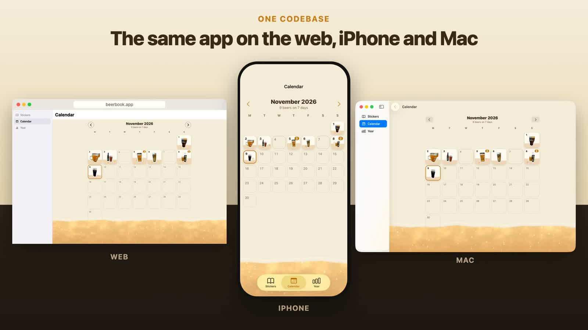
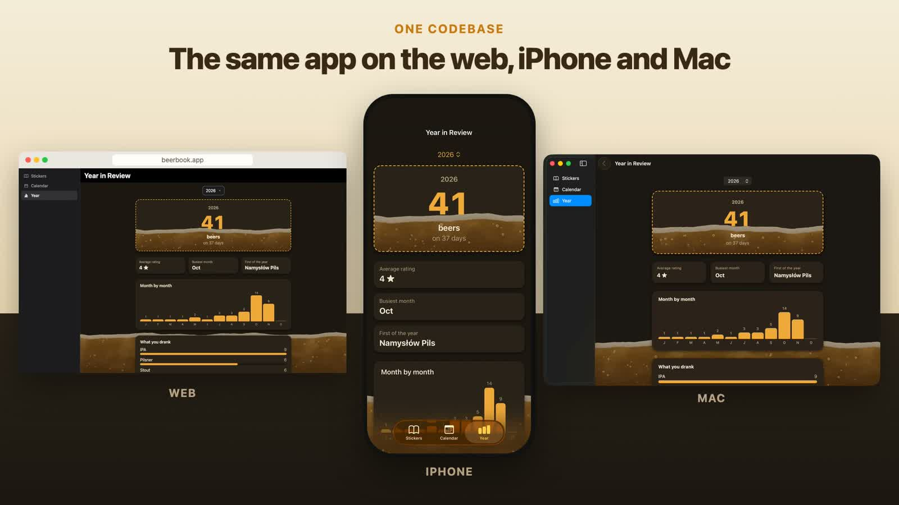

# Beer Book

**An example app built with Exact, the new framework from Expo.** One
codebase runs as a website, a native iPhone app and a native Mac app, in light and dark mode.



Beer Book is a sticker album for the beers you drink. Photograph a beer and the app cuts it out
into a die-cut sticker, then files it in an album, on a calendar and in a Year in Review.

> This is a demo project meant to show what an Exact app looks like end to end. It isn't a
> product, and it isn't maintained as one.

## What's in it

- **Album:** your stickers in a grid, filtered by style and sorted by date or rating. Each
  sticker opens a page with its brewery, style, glass, place, date and rating.
- **Add a beer:** pick a photo; on iPhone and Mac the subject is lifted out with Apple's Vision
  framework into a sticker with a white die-cut edge (`modules/apple/Stickers.swift`). The web
  keeps the photo in a white frame.
- **Calendar:** a month at a time, each day showing the sticker of what you drank, with a day
  page listing every beer.
- **Year in Review:** totals, busiest month, average rating, month-by-month bars, top styles,
  breweries and places, and your favourites.
- **A beer shader:** the liquid at the foot of every page is a WGSL fragment shader
  (`gpu/shaders/brew.wgsl`): a moving surface, a foam head, light caustics and rising bubbles.
  It runs on Metal on Apple and WebGPU on the web, from the same source.
- **Demo mode:** long-press (right-click on the Mac and web) the month name on the Calendar tab
  to load a year of demo beers, or remove them again. Your own beers are never touched.



## How it's built

Everything platform-specific is the platform's own: UIKit on iPhone, AppKit on the Mac, the DOM
on the web. The app describes what each screen is, and Exact draws it natively.

| File | What it is |
|---|---|
| `app.contract` | The whole UI in Contract, Exact's view language: routes, tabs, screens, sheets, alerts |
| `app.ts` | The data module in TypeScript: SQLite storage, the calendar and review, demo data |
| `app.test.contract` | The tests, driven on every platform |
| `app.tamber` | The palette (paper, ink, amber), light and dark |
| `gpu/` | The GPU module: the `brew` shader and its Rust surface |
| `modules/apple/Stickers.swift` | The native module that cuts a photo out into a sticker |
| `assets/demo/` | The demo beers' stickers (`tools/demo-stickers.swift` made them) |
| `web/`, `apple/`, `Cargo.toml` | The Rust shells for the web and Apple hosts, with the GPU crate |

Beers stay on the device; nothing is sent anywhere.

## Running it

The app expects an Exact checkout next to it at `../exact` (set `EXACT2` to use another path),
plus [Bun](https://bun.sh), Rust and, for Apple platforms, Xcode.
`bun ../exact/scripts/exact.mjs setup --check` lists anything missing.

```sh
bun exact.mjs web          # the website, rebuilt on save
bun exact.mjs ios --run    # the iPhone app in the simulator
bun exact.mjs mac --run    # the Mac app
bun exact.mjs test         # the tests
bun exact.mjs verify       # tests plus layout, contrast and text-size checks
```

## Credits

The demo stickers are cut from the author's own photos. The beer names belong to their
breweries and appear only as sample data.
